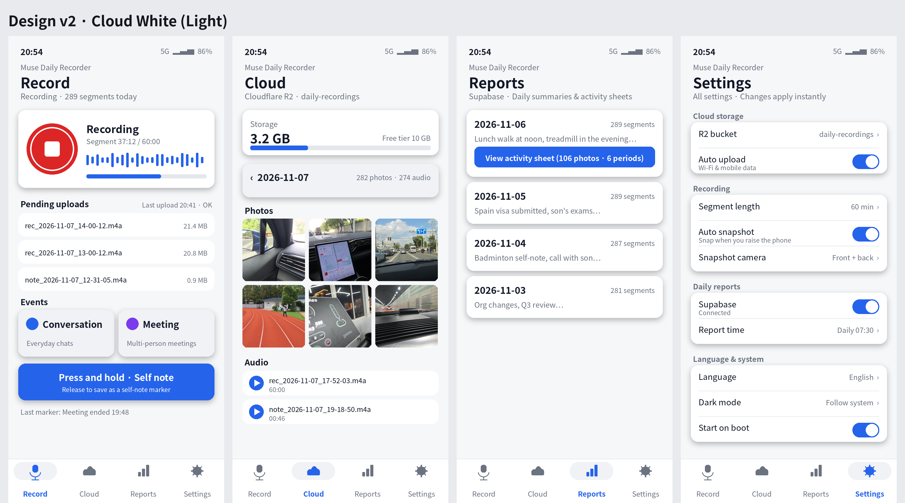
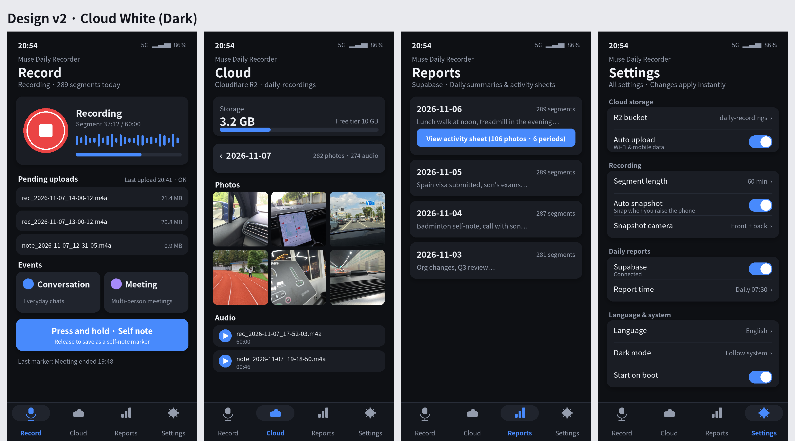

# Muse Daily Recorder

[English](README.md) · [简体中文](README.zh-CN.md) · [日本語](README.ja.md) · [한국어](README.ko.md) · [Español](README.es.md) · Français · [Deutsch](README.de.md) · [Português](README.pt.md) · [Русский](README.ru.md)

**Version actuelle : v1.14.0**

Une application Android compagnon pensée pour enregistrer toute la journée. Le téléphone vous accompagne partout : il remplace le dictaphone. Les enregistrements sont segmentés automatiquement, sauvegardés dans votre propre stockage cloud, et — grâce aux marqueurs d'événements, aux transcriptions et au résumé quotidien — deviennent des archives que l'on peut vraiment rechercher et relire. Ni câbles, ni fichiers perdus.

Muse ne peut pas écouter un micro en continu ; le système comporte donc trois parties :

1. **L'application Android** (`MuseRecorder.apk`) : un enregistreur en service de premier plan qui découpe un nouveau segment toutes les 60 minutes et envoie chaque segment terminé vers votre propre stockage compatible S3. La transcription et les résumés se font côté Muse.
2. **Les marqueurs d'événements** : marquez les moments importants pendant l'enregistrement ; les marqueurs sont envoyés dans le bucket avec l'audio.
3. **Le récepteur + le résumé quotidien** : les scripts de `receiver/` récupèrent l'audio et les marqueurs d'une journée depuis le bucket, les transcrivent, puis stockent dans Supabase les transcriptions par segment, les analyses et un résumé quotidien.

## Fonctionnalités

- **Enregistrement segmenté + envoi automatique** — un nouveau segment .m4a toutes les 60 minutes (environ 21 Mo chacun), envoyé automatiquement vers un stockage objet compatible S3 (Cloudflare R2, Backblaze B2, Alibaba Cloud OSS, Tencent Cloud COS, AWS S3, Qiniu Kodo ou tout point de terminaison personnalisé ; préréglages inclus). Les envois échoués patientent dans une file et réessaient d'eux-mêmes ; une liste des envois en attente montre ce qui reste.
- **Marqueurs d'événements** — un interrupteur Conversation et un interrupteur Réunion encadrent ce qui compte ; le rapport quotidien organise le contenu en conséquence.
- **Notes personnelles par appui long** — maintenez le bouton dès qu'une idée vous vient ; pendant un enregistrement, cela marque l'instant, au repos, cela enregistre une note vocale indépendante.
- **Photo automatique (optionnelle, désactivée par défaut)** — levez le téléphone de la position à plat à la verticale et il prend discrètement une photo (caméra arrière, avant, ou les deux). Tant que l'enregistrement tourne, les photos fonctionnent aussi écran éteint. Le choix de la caméra s'applique immédiatement.
- **Onglet Cloud** — parcourez votre bucket par date : carte d'utilisation du stockage (par rapport aux 10 Go gratuits de R2), nombre de photos et d'audios par jour, grille de vignettes photo, lecture audio d'un toucher.
- **Onglet Rapports** — les résumés quotidiens issus de Supabase et, pour chaque jour, une « feuille d'activité quotidienne » : un collage d'environ 1 Mo réunissant les photos les plus nettes de la journée, regroupées par période d'activité, avec une courte légende par période.
- **Mode sombre** — suivre le système, toujours clair ou toujours sombre (Réglages → Langue et système).
- **Interface en 9 langues** — anglais, chinois simplifié, japonais, coréen, espagnol, français, allemand, portugais, russe ; le changement est immédiat. Le nom de l'application reste « Muse Daily Recorder » dans toutes les langues.

## Design

Design v2 « Cloud White » — des cartes épurées, un seul accent bleu, une barre d'onglets en bas :





Variantes claire et sombre d'un même design. Remarque : l'onglet Enregistrement est livré dans la disposition compacte classique montrée ici (bouton d'enregistrement et forme d'onde sur la même ligne, cartes fixes en pied) — un précédent redesign en grande carte occupait trop de place verticale et a été abandonné dans la v1.14.0.

## Pour commencer

### 1. Préparer un bucket S3 (exemple avec Cloudflare R2)

1. Inscrivez-vous sur cloudflare.com et activez R2 (offre gratuite : 10 Go, téléchargements gratuits ; l'activation peut demander une carte, mais rien n'est facturé dans le quota gratuit). Créez un bucket, par exemple `recordings`.
2. Dans « Manage R2 API Tokens », **créez un token avec un accès en lecture et écriture limité à ce seul bucket** (Object Read & Write, porté sur le bucket). Notez l'Access Key ID, la Secret Access Key et votre Account ID (le point de terminaison est `https://<AccountID>.r2.cloudflarestorage.com`).
3. Dans l'application, choisissez le préréglage **Cloudflare R2**, remplacez `<AccountID>` dans le point de terminaison par votre ID réel, renseignez le nom du bucket et les deux clés, puis enregistrez.

Les autres fournisseurs fonctionnent de la même façon (tous ont des préréglages). Alibaba/Tencent/AWS/Qiniu demandent de cocher « virtual-host style » ; R2/B2 non. Les noms de bucket Tencent portent un suffixe `-APPID` et utilisent SecretId/SecretKey.

### 2. Installation et usage quotidien

1. Téléchargez l'APK depuis les [Releases](https://github.com/skyvense/muse-recorder/releases) (la release permanente `latest` contient toujours le build le plus récent ; les releases versionnées sont conservées pour toujours), envoyez-le sur le téléphone et installez-le (application personnelle installée manuellement : autorisez les « sources inconnues » une fois). Une installation par-dessus une ancienne version conserve vos réglages.
2. Ouvrez l'application → ⚙️ Réglages : renseignez S3 et enregistrez (l'enregistrement déclenche aussitôt un envoi) → autorisez l'exécution en arrière-plan (désactivez l'optimisation de la batterie ; sur les téléphones Samsung, réglez aussi la batterie de l'application sur « Sans restriction ») → revenez à l'onglet Enregistrement et touchez le bouton rond rouge pour démarrer (il devient un carré pendant l'enregistrement, avec forme d'onde en direct et progression du segment en cours).
3. **Les envois sont entièrement automatiques** : la liste des envois en attente montre l'état de chaque segment, la progression s'affiche pendant l'envoi et le résultat reste à l'écran ensuite — avec le message d'erreur du serveur en cas d'échec. Le bouton manuel « réessayer maintenant » n'apparaît qu'après un changement de réglage ou après plus de 30 minutes d'échecs des réessais automatiques.
4. Le bouton ⓘ en haut à droite ouvre une page d'aide intégrée (enregistrement, envoi, marqueurs, réglages, FAQ, confidentialité).

Les marqueurs sont stockés par jour dans le bucket, dans `markers/events-<date>.jsonl`. L'état des interrupteurs est mémorisé : fermer et rouvrir l'application ne les dérègle jamais.

## Pipeline de résumé quotidien (côté Muse)

```bash
# Variables d'environnement : S3_ENDPOINT / S3_BUCKET / S3_ACCESS_KEY / S3_SECRET_KEY / S3_REGION / S3_STYLE (path|virtual)
# Optionnel : S3_DELETE_AFTER=1 → supprime les originaux du cloud après récupération (transcriptions et rapports restent)
python3 receiver/fetch_day_from_s3.py --date 2026-10-23
python3 receiver/summarize_day.py   --date 2026-10-23
```

Transcription, deux options : définir `OPENAI_API_KEY` (API Whisper), ou `pip install faster-whisper` pour transcrire localement et gratuitement. Indiquez à Muse une heure de rapport (p. ex. chaque matin à 7 h 30) et une tâche planifiée pourra exécuter le pipeline automatiquement et publier le rapport dans la conversation.

## Confidentialité et sécurité

- L'audio part **uniquement vers votre propre bucket** — aucun serveur tiers dans la boucle.
- La transcription peut tourner **entièrement en local** (faster-whisper) ; rien ne doit quitter votre machine, hormis le stockage que vous avez choisi.
- **Aucun identifiant dans ce dépôt.** La clé secrète S3 n'existe que dans les réglages de l'application sur le téléphone ; les clés Supabase des scripts récepteurs vivent dans des fichiers env locaux, hors du dépôt. Limitez les tokens de stockage à un seul bucket pour contenir toute fuite éventuelle.
- Enregistrer d'autres personnes exige leur consentement dans de nombreux endroits — n'enregistrez que là où c'est légal et où l'autre partie est au courant.

## À quoi s'attendre, en vrai

- **Batterie** : enregistrer toute la journée consomme environ 3 à 6 % par heure ; enregistrez en charge pendant la nuit si possible. L'option « envoi en Wi-Fi uniquement » est disponible.
- **Stockage** : environ 500 Mo par jour. Les copies locales sont supprimées après un envoi réussi par défaut ; côté cloud, utilisez `S3_DELETE_AFTER=1` ou une règle de cycle de vie du bucket ne conservant que les derniers jours.
- **Stabilité** : Android restreint fortement l'enregistrement en arrière-plan ; la notification persistante dans la barre d'état est une exigence du système (et la preuve que l'enregistrement tourne).

## Compilation et publication

- `build-apk.sh` compile l'APK directement avec les build-tools du SDK Android (aucun Gradle nécessaire pour le build de publication).
- Chaque push sur `master` déclenche GitHub Actions, qui compile un APK **signé** et publie deux releases contenant le même fichier : une release permanente `latest` et une release versionnée `vX.Y.Z`. Installation depuis les [Releases](https://github.com/skyvense/muse-recorder/releases).
- `muse-recorder.keystore` + `keystore-info.txt` constituent la clé de signature — **gardez-les précieusement**. Les mises à jour doivent être signées avec la même clé, sinon elles ne peuvent pas s'installer par-dessus l'ancienne version. Des copies chiffrées se trouvent dans `vault/` (AES-256-CBC + PBKDF2).

## Structure du dépôt

- `app-project/` : le code complet de l'application (Java + API du framework Android ; la signature S3 est une implémentation SigV4 en Java pur, vérifiée avec les vecteurs de test officiels d'AWS).
- `receiver/` : le pipeline côté Muse — `fetch_day_from_s3.py` (récupère audio + marqueurs + photos depuis le bucket ; bibliothèque standard Python uniquement, signature vérifiée avec les mêmes vecteurs officiels), `summarize_day.py` (transcription + brouillon du rapport), scripts d'écriture Supabase et générateurs de feuilles photo. `receiver/server.py` et `fetch_day_from_supabase.py` sont des archives de l'ancienne approche v1.0/v1.1.
- `docs/images/` : les images de design utilisées ci-dessus.
- `README.<langue>.md` : ce même fichier dans les 8 autres langues.

Depuis la v1.2, l'application est **S3 uniquement** (le récepteur auto-hébergé de la v1.0 et l'envoi direct vers Supabase de la v1.1 ont été retirés de l'application ; les scripts restent dans `receiver/` à titre de référence).
